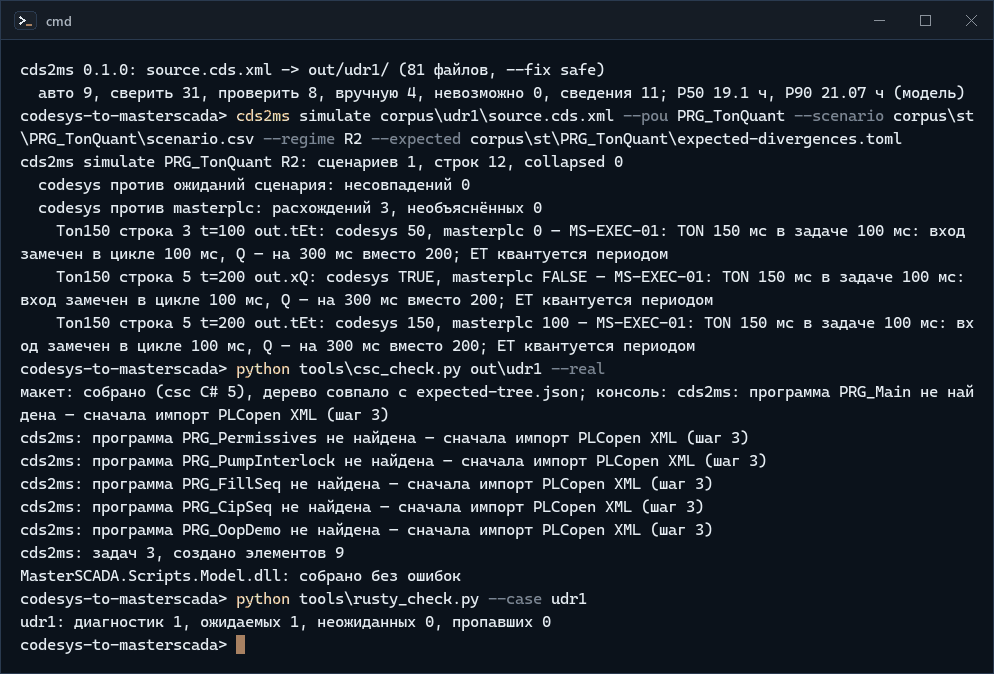
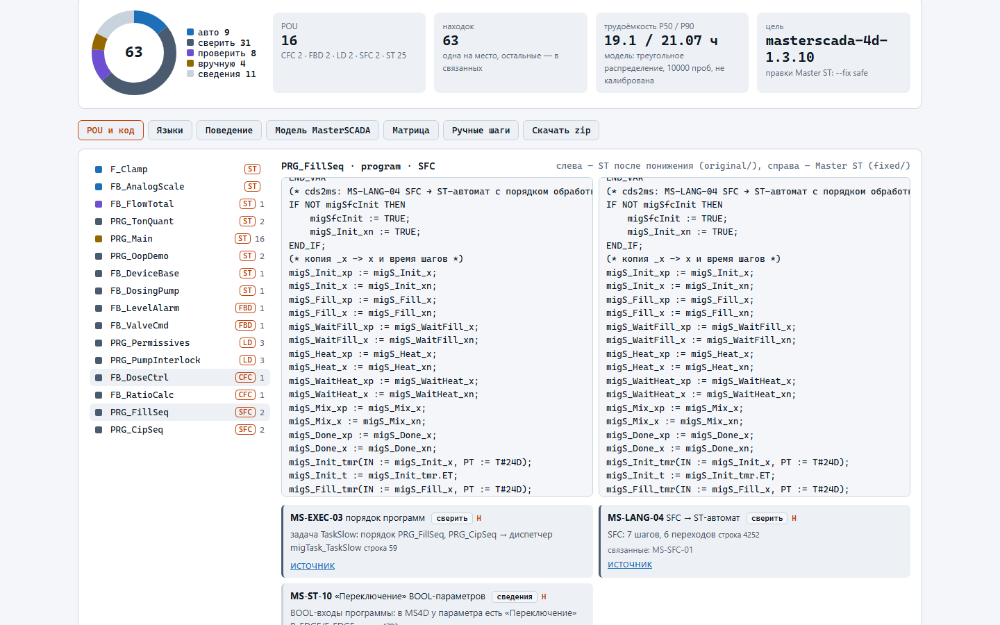
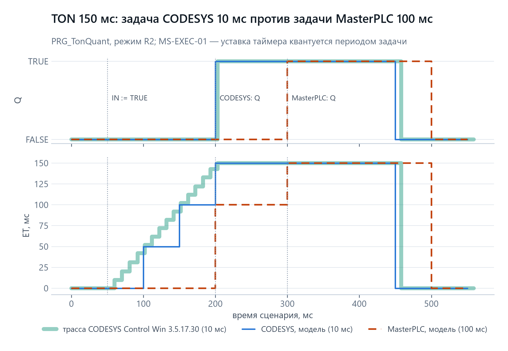
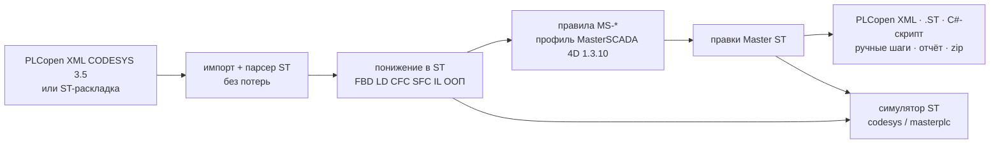

<p align="center">
  <picture>
    <source media="(prefers-color-scheme: dark)" srcset="docs/media/banner-dark.svg">
    <source media="(prefers-color-scheme: light)" srcset="docs/media/banner-light.svg">
    
  </picture>
</p>

<p align="center">
  <a href="https://github.com/kr0nsch/codesys-to-masterscada/actions/workflows/ci.yml"></a>
  <a href="LICENSE"></a>
  <a href="https://kr0nsch.github.io/codesys-to-masterscada/"></a>
  
  
  
</p>

<p align="center">
  <a href="#демонстрация">Демо</a> ·
  <a href="#архитектура">Архитектура</a> ·
  <a href="#быстрый-старт">Быстрый старт</a> ·
  <a href="docs/">Документация</a> ·
  <a href="#summary-en">Summary (EN)</a>
</p>

**cds2ms** переносит проект CODESYS 3.5 в MasterSCADA 4D 1.3.10 / MasterPLC и за минуты отвечает на три вопроса:
что из проекта попадёт в MasterSCADA автоматически и каким документированным каналом, что после переноса будет
работать иначе, что придётся делать руками и сколько это займёт.

**Зачем.** Один и тот же ПЛК ОВЕН (ПЛК210, ПЛК200) программируется и в CODESYS V3.5, и в MasterSCADA 4D, а
отечественный MasterPLC — в реестре российского ПО; поставки CODESYS в РФ закрыты, иностранное ПО на значимых
объектах КИИ запрещено с 2025 года. Инструмента переноса у вендора нет, формат проекта MasterSCADA закрыт, а
импорт PLCopen XML берёт только ST. Ловушки компилируются молча: задачи по умолчанию 100 мс и TON 150 мс
срабатывает через 200; в SFC только N и P1 со сдвигом на цикл; `DT` по умолчанию 0001-01-01; ООП и
указателей в справке нет.

**Для кого.** Интеграторы и инженеры ОВЕН/CODESYS, которые переводят объекты на MasterSCADA 4D и MasterPLC:
оценить объём до договора, получить перенесённый ST и план ручных шагов, а не переписывать с нуля.

**Что внутри.** Все шесть языков CODESYS (ST, FBD, LD, CFC, SFC, IL) и ООП понижаются в ST; 54 правила MS-* со
ссылками на справку 1.3.10 правят код под Master ST; на выходе — PLCopen XML (валиден по XSD TC6 2.01), файлы
`.ST`, C#-скрипт для среды разработки MasterSCADA (собирается против её `MasterSCADA.Scripts.Model.dll` 1.3.10),
ручные шаги с минутами и отчёт с матрицей автоматизируемости. Поведение до и после проверяет симулятор ST в
двух профилях, а понижение языков сверено с трассами настоящего CODESYS Control Win.

## Демонстрация

<p align="center">
  
</p>
<p align="center"><sub>Реальная сессия на экспорте CODESYS 3.5.17.30 (корпус УДР-1), снято term2gif.py</sub></p>

**Живое демо:** [kr0nsch.github.io/codesys-to-masterscada](https://kr0nsch.github.io/codesys-to-masterscada/) — тот же
код в браузере (Python в WebAssembly, файл никуда не отправляется): дерево POU с языком и исходом, исходный ST и
Master ST рядом, карточки находок со ссылкой на справку, трассы CODESYS и MasterPLC, ручные шаги, zip. Страница
пересчитывает пример в браузере и сверяет SHA-256 zip с предрасчётом командной строки.

<p align="center">
  <picture>
    <source media="(prefers-color-scheme: dark)" srcset="docs/media/shot-demo-pous-dark.png">
    
  </picture>
</p>
<p align="center"><sub>Снимок страницы демо (Chromium, Playwright), пример «УДР-1 (экспорт CODESYS)»</sub></p>

<p align="center">
  <picture>
    <source media="(prefers-color-scheme: dark)" srcset="docs/media/chart-ton-quantization-dark.png">
    
  </picture>
</p>
<p align="center"><sub>PRG_TonQuant в режиме R2: широкая линия — трасса стенда в CODESYS Control Win 3.5.17.30, остальное — <code>cds2ms simulate</code></sub></p>

## Быстрый старт

Нужен только Python 3.11+ (пакет без зависимостей). CODESYS и MasterSCADA не нужны.

```bash
git clone https://github.com/kr0nsch/codesys-to-masterscada
cd codesys-to-masterscada
python -m venv .venv && . .venv/bin/activate      # Windows: .venv\Scripts\activate
pip install -e .

cds2ms inventory corpus/udr1/source.cds.xml        # POU 16, языки CFC 2, FBD 2, LD 2, SFC 2, ST 25; задачи 3
cds2ms analyze corpus/udr1/source.cds.xml --top 6 --fail-on never
#   авто 9, сверить 31, проверить 8, вручную 4, невозможно 0, сведения 11; P50 19.1 ч, P90 21.07 ч (модель)
cds2ms migrate corpus/udr1/source.cds.xml --out out/udr1 --zip out/udr1.zip --fail-on never
#   cds2ms 0.1.0: source.cds.xml -> out/udr1/ (81 файлов, --fix safe)
cds2ms simulate corpus/udr1/source.cds.xml --pou PRG_TonQuant --scenario corpus/st/PRG_TonQuant/scenario.csv \
  --regime R2 --expected corpus/st/PRG_TonQuant/expected-divergences.toml
#   codesys против masterplc: расхождений 3, необъяснённых 0 (MS-EXEC-01)
```

`corpus/udr1/source.cds.xml` — настоящий экспорт CODESYS 3.5.17.30 (корпус УДР-1 после `import_xml` и сборки).
Коды выхода: 0 — успех, 1 — есть находки не легче `--fail-on` (по умолчанию `manual`) или необъяснённые
расхождения, 2 — ошибка входа.

## Как использовать в своём проекте

1. **Экспорт из CODESYS.** В дереве устройств — узел Application → «Экспорт PLCopenXML…» (или выбранные объекты).
   Подойдёт и ST-раскладка `src/POUs/…` из git (формат s7-to-codesys).
2. **Оценка.** `cds2ms analyze проект.xml --format html > отчёт.html` — находки по POU с исходом, ссылкой на
   справку и минутами, матрица автоматизируемости, P50/P90.
3. **Перенос.** `cds2ms migrate проект.xml --out out/проект --node <имя узла ПЛК в MasterSCADA> --fix review`:

   | Что в `out/проект/` | Куда |
   |---|---|
   | `import/<имя>.plcopen.xml` | узел ПЛК → «Импортирование PLCOpenXML» (только ST: ФБ и функции — в локальную библиотеку, программы и глобальные — в узел) |
   | `script/DoAction.body.cs` | элемент «Скрипт» → тело `DoAction()`: задачи узла и программы-диспетчеры с порядком задач CODESYS |
   | `MANUAL_STEPS.md` | по шагам: смена исполнительной системы, импорт, «Проверить» проекта целиком, скрипт, связи, «Сохранять», задачи, эмуляция — с ожидаемым результатом и минутами |
   | `io-binding.csv`, `tasks.md`, `mapping.csv` | каналы ввода-вывода, задачи, соответствие объектов |
   | `fixed/`, `changes.diff`, `MIGRATION_REPORT.*` | Master ST, разница с исходным ST, отчёт |

4. **Поведение.** Если у POU есть сценарий (CSV формата s7-to-codesys), `cds2ms simulate` прогонит исходный ST
   (профиль `codesys`) и Master ST (профиль `masterplc`); каждое расхождение должно быть объяснено правилом в
   `expected-divergences.toml`, иначе код выхода 1.
5. **Проверка в MasterSCADA.** Импорт и «Проверить» делает человек: пробы `probe/` (≈ 2,5 ч) и
   `cds2ms profiles apply-probe probe/RESULTS.csv --write` переводят статусы профиля из «не описано» в «проверено».

Уровни правок: `--fix none` (только отчёт), `safe` (переименования, `S=`/`R=`, типы — по умолчанию), `review`
(плюс структурировщик переходов, `STRING(n)`, EN/ENO), `all` (плюс неописанное, только с `--rewrite-undocumented ID`).

## Шесть языков

| Язык | Как переносится | Чем сверено |
|---|---|---|
| ST | без понижения; правки Master ST по правилам MS-* | трасса CODESYS Control Win (3 POU) |
| FBD | сети → ST по потоку данных, `jump`/`return` — структурировщик | трасса CODESYS Control Win (2 POU) + property-тесты DAG |
| LD | цепи → булевы выражения, катушки S/R, фронты через R_TRIG/F_TRIG | трасса CODESYS Control Win (2 POU) + property-тесты цепей |
| CFC | порядок `executionOrderId`, обратные связи — значение прошлого цикла | трасса CODESYS Control Win (2 POU) + property-тесты с обратными связями |
| SFC | ST-автомат с порядком обработки CODESYS (IEC-действия N, P, S, R, L, D, последний вызов) | трасса CODESYS Control Win (2 POU) |
| IL | стековая машина CR → ST | **собственный вычислитель**: IL в CODESYS 3.5.17.30 без опции «Enable IL» не импортируется |
| ООП | «режим вызова»: методы — ветки `migCall`, свойства — выходы, EXTENDS и `SUPER^` — встраивание | трасса CODESYS Control Win (FB_DosingPump EXTENDS FB_DeviceBase IMPLEMENTS I_Device) |

Трассы: 12 POU, 200 циклов задачи 10 мс в CODESYS Control Win 3.5.17.30, все совпали с понижением в симуляторе.
Первая съёмка нашла две ошибки модели — IEC-действие в последнем вызове видит `_Действие.x = TRUE`, а отвод после
катушки LD import_xml сводит в общий узел — подробности в [ORACLES.md](docs/ORACLES.md). Какие формы принимает
`import_xml` CODESYS по языкам — [FORMAT-OUT.md](docs/FORMAT-OUT.md).

## Что автоматизируемо

| Автоматически | Со сверкой человеком | Вручную |
|---|---|---|
| POU на ST, STRUCT/ENUM/массивы, GVL → параметры узла, псевдонимы и поддиапазоны, блоки Standard | понижение FBD/LD/CFC/SFC/IL, методы и свойства, EXTENDS, задачи и порядок программ (скрипт), RETAIN/PERSISTENT, `AT %I/%Q` | интерфейсы и полиморфизм, UNION, указатели, библиотеки Util/CAA/ОВЕН, устройства и Modbus; визуализация не переносится |

Полная матрица «конструкция × канал × исход × уверенность» — [AUTOMATABILITY.md](docs/AUTOMATABILITY.md), реестр
правил — [RULES.md](docs/RULES.md).

## Цепочка S7 → CODESYS → MasterSCADA

Выход [s7-to-codesys](https://github.com/kr0nsch/s7-to-codesys) @2285760 (66 файлов ST-раскладки, MIT) переносится
дальше в MasterSCADA: сценарии s7-to-codesys (6 блоков, 263 строки) дают 0 несовпадений и 0 расхождений
CODESYS ↔ MasterPLC, round-trip лексера — 66 из 66 файлов. Второй реальный кейс —
[plc-process-lib](https://github.com/kr0nsch/plc-process-lib) с ООП (68 методов и 19 свойств в ФБ, 7 интерфейсов):
436 находок, ложных по истине `truth.json` — 2 (0,5 %), P50 33,3 ч ([CASE_PROCESSLIB.md](docs/CASE_PROCESSLIB.md)).

## Архитектура



Пакет `src/cds2ms` — только стандартная библиотека Python, поэтому тот же код работает в браузере. Подробно —
[ARCHITECTURE.md](docs/ARCHITECTURE.md).

## Как проверено

| Проверка | Итог |
|---|---|
| pytest (unit, корпус правил, property, корпус и трассы, кейсы, CLI, C#, RuSTy) | 313 тестов, покрытие `cds2ms` 87,6 % строк / 78,6 % ветвей (локально, Windows 11 с CODESYS и MasterSCADA) |
| property-тесты (hypothesis, 500 примеров на свойство, фиксированная выборка) | графы FBD/CFC, цепи LD, IL, лексер, правки — нашли и закрыли два дефекта понижения |
| трассы CODESYS Control Win 3.5.17.30 | 12 POU / 200 циклов совпали |
| XSD TC6 2.01 (plcopen.org, по SHA-256) | все XML выходы валидны (в CI обязательно) |
| RuSTy 1.0.6 `plc --check` над Master ST | 0 неожиданных и 0 пропавших диагностик на трёх кейсах; RuSTy нашёл дефект переименования формальных параметров — исправлен |
| C#-скрипт | собран csc C# 5 и dotnet против макета API; тело собрано против `MasterSCADA.Scripts.Model.dll` 1.3.10; снимок API (156 имён) совпал с XML-документацией поставки |
| демо (Playwright) | число находок = CLI, SHA-256 zip в браузере = CLI, ни одного чужого домена |
| ruff, `mypy --strict` | чисто |

## Чего инструмент не делает

- Не пишет и не читает файлы проекта MasterSCADA (`.fdb`, `.ms4proj`): формат закрыт, EULA запрещает обратную
  разработку. Канал — только документированные PLCopen XML, `.ST` и скрипт внешней объектной модели.
- Не проверялся импорт в MasterSCADA 4D: на машине автора стоит 1.3.10 Demo, но импорт, «Проверить» и эмуляция
  есть только в GUI — это шаги владельца ([HARDWARE_VALIDATION.md](docs/HARDWARE_VALIDATION.md)). Нельзя говорить
  «импортируется» или «совместимо с MasterPLC», пока пробы не пройдены.
- Не переносит визуализацию, тревоги, устройства и каналы ввода-вывода (создаёт `io-binding.csv` и ручные шаги).
- Симулятор `masterplc` — модель по справке, не эмулятор MasterPLC: неописанное прогоняется во всех вариантах.
- Трудоёмкость P50/P90 — модель (треугольное распределение минут правил), не калибрована.
- Формат `.ST` черновой: справка его не описывает, уточняется пробой P-CS-03.

## Тесты и разработка

```bash
pip install -e . -r requirements-dev.txt
python -m ruff check . && python -m ruff format --check . && python -m mypy
python -m pytest --cov=cds2ms --cov-branch --cov-report=json:build/coverage.json && python tools/check_coverage.py
python tools/build_site.py && python tools/e2e_smoke.py     # демо + Playwright (playwright install chromium)
```

С CODESYS 3.5.17.30: `python tools/codesys/corpus.py` — корпус в CODESYS, экспорт, стенды и трассы в Control Win
(под блокировкой общего рантайма). С MasterSCADA 4D: `python tools/csc_check.py out/udr1 --real`,
`python tools/ms4d_check.py`. Правила разработки — [CONTRIBUTING.md](CONTRIBUTING.md).

## Документация

| Документ | Что |
|---|---|
| [ARCHITECTURE.md](docs/ARCHITECTURE.md) | модули, понижение по языкам, каналы MasterSCADA |
| [FORMAT-OUT.md](docs/FORMAT-OUT.md) | этап 0: что принимает import_xml CODESYS по языкам; что cds2ms читает и пишет |
| [ORACLES.md](docs/ORACLES.md) | трассы CODESYS, собственные вычислители, модели сценариев |
| [RULES.md](docs/RULES.md) | 54 правила MS-* с источниками |
| [AUTOMATABILITY.md](docs/AUTOMATABILITY.md) | матрица автоматизируемости и тихие ловушки |
| [HARDWARE_VALIDATION.md](docs/HARDWARE_VALIDATION.md) | что проверено без GUI и пробы владельца в MasterSCADA 4D |
| [CASE_PROCESSLIB.md](docs/CASE_PROCESSLIB.md) | кейс plc-process-lib: счёт конструкций, FP/FN по истине |
| [ASSUMPTIONS.md](docs/ASSUMPTIONS.md), [SOURCES.md](docs/SOURCES.md), [ROADMAP.md](docs/ROADMAP.md) | допущения, источники, срезы и планы |

## Summary (EN)

**cds2ms** migrates CODESYS 3.5 projects to MasterSCADA 4D 1.3.10 / MasterPLC (the Russian SCADA/PLC platform used
with OWEN controllers). It imports PLCopen XML with 3S extensions (or an ST source layout), lowers all six IEC 61131-3
languages (ST, FBD, LD, CFC, SFC, IL) and CODESYS OOP to Structured Text, applies 54 documented rules for the Master ST
dialect, and emits a TC6 2.01 PLCopen XML (ST bodies only, XSD-valid), `.ST` files, a C# 5 project-building script for
the MasterSCADA development environment (compiled against the shipped `MasterSCADA.Scripts.Model.dll` 1.3.10), manual
steps with time estimates, and an automatability report with P50/P90 effort. A built-in ST simulator runs scenarios in
`codesys` and `masterplc` profiles (task-period quantisation, DT defaults, unknown semantics as variants); every
divergence must be explained by a rule. The lowering was checked against CODESYS Control Win 3.5.17.30 runtime traces
(12 POUs, 200 cycles; IL could not be imported without the "Enable IL" option and is checked by an independent stack
evaluator). Import into MasterSCADA itself is GUI-only and is left to the owner with a ready probe kit. The same core
runs in the browser via Pyodide: [live demo](https://kr0nsch.github.io/codesys-to-masterscada/).

## Лицензия

MIT — [LICENSE](LICENSE). Корпус `corpus/s7-chain/` — копия выхода s7-to-codesys @2285760 (MIT, тот же автор).

Проект не связан с компаниями ОВЕН, Прософт-Системы, РегЛаб, ООО «ИЭК ДИДЖИТАЛ» и CODESYS GmbH; названия
продуктов — товарные знаки их владельцев.

---

<p align="center"><b>Миграция ПЛК-проектов</b></p>
<table>
<tr><td width="33%"><a href="https://github.com/kr0nsch/codesys-to-s7">01 · codesys-to-s7</a><br><sub>CODESYS → Siemens S7: SCL, SimaticML, round-trip</sub></td><td width="33%"><a href="https://github.com/kr0nsch/codesys-to-astra">02 · codesys-to-astra</a><br><sub>CODESYS → REGUL/Astra.IDE: библиотеки, ввод-вывод</sub></td><td width="33%"><a href="https://github.com/kr0nsch/codesys-to-polygon">03 · codesys-to-polygon</a><br><sub>CODESYS → «Полигон»: анализ и перенос в FBD</sub></td></tr>
<tr><td width="33%"><a href="https://github.com/kr0nsch/codesys-to-masterscada"><b>04 · codesys-to-masterscada</b></a><br><sub>CODESYS → MasterSCADA 4D: логика и объекты</sub></td><td width="33%"><a href="https://github.com/kr0nsch/codesys-to-forgelogic">05 · codesys-to-forgelogic</a><br><sub>CODESYS → МЭК 61499: ФБ, события, 4diac</sub></td></tr>
</table>
<p align="center"><sub>Обратное направление — <a href="https://github.com/kr0nsch/s7-to-codesys">s7-to-codesys</a> (Siemens S7 → CODESYS); перенос в ALTA IDE — <a href="https://github.com/kr0nsch/alta-port">alta-port</a>.</sub></p>
