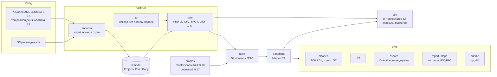

# Архитектура cds2ms

Пакет `cds2ms` — только стандартная библиотека Python 3.11+ (тот же код работает в Pyodide на странице демо).

| Каталог | Что | Ключевые решения |
|---|---|---|
| `cdsfront/importer` | `plcopen.py` (три размещения POU, CFC в addData, методы/свойства/интерфейсы, задачи, библиотеки), `layout.py` (ST-раскладка), `xmltree.py` (expat с номерами строк) | у каждого объекта — `Origin(file, line, col, localId)`: находка указывает место в исходном файле |
| `cdsfront/st` | лексер с trivia (пробелы и комментарии — токены), рекурсивный парсер с восстановлением, печать | `join(tokenize(t)) == t` для любого текста; правки — заменами диапазонов токенов, форматирование не трогается |
| `cdsfront/lower` | `graph.py` (FBD/LD/CFC), `sfc.py`, `il.py`, `jumps.py` (структурировщик переходов), `oop.py` (режим вызова) | один структурировщик для ST JMP, графики и IL: переходы вперёд → `IF`, иначе автомат `migPc`; понижение выполняется всегда, исход — в заметках |
| `ir` | модель проекта | без зависимостей от формата |
| `profiles` | TOML: возможности цели (status, confidence, source), семантика, варианты `unknown` | профиль версионирован: новая версия MS4D — новый файл |
| `rules` | реестр (ID, исход, источник, описание), движок, дедупликация (одна находка на место, остальные — `related`) | реестр падает без корпуса `tests/rules/<ID>/` и URL |
| `transform` | правки Master ST по уровням `--fix none\|safe\|review\|all` | `fix(fix(x)) == fix(x)`; результат не зависит от порядка правил |
| `emit` | XML, `.ST`, C#, отчёт, ручные шаги, mapping, zip | zip `ZIP_STORED` с фиксированными датами — одинаков на всех ОС и в браузере |
| `sim` | интерпретатор ST над тем же парсером: ФБ Standard, таймеры, строки, массивы, структуры; режимы R1/R2 | профиль `codesys` и профиль `masterplc` (квантование задачи, `DT`, строки, варианты `unknown`) |
| `web.py` | вход демо: XML / zip / JSON раскладки → то же представление, что у CLI | |

## Понижение по языкам

- **FBD** — сети по `localId div 10^10`; блок с одним потребителем встраивается в выражение, иначе — переменная;
  EN → `IF` над вызовом, ENO — переменная; `jump`/`label`/`return` → структурировщик.
- **LD** — цепь → булево выражение (параллель — OR, последовательность — AND); катушки S/R → `IF … THEN x := TRUE`;
  фронтовые контакты — экземпляры `R_TRIG`/`F_TRIG`; одна левая шина экспорта CODESYS доступна каждой сети.
- **CFC** — порядок `executionOrderId`; выход блока — переменная `migCfcN`; вход от блока с бо́льшим номером читает
  значение прошлого цикла; безымянный `connector` — узел провода.
- **SFC** — ST-автомат с порядком CODESYS за цикл: копия `_x → x`, время шагов (`TON` на шаг), блоки управления
  IEC-действий (N, P, S/R, L, D; P0/P1 — для экспортов других сред), действия по алфавиту в два прохода (сначала
  последний вызов деактивированных, затем активные), переходы. `_Действие.x` — «выполняется» (TRUE и в последнем вызове),
  `_Действие._x` — «активно».
- **IL** — стековая машина CR → ST (`AND(`…`)`, модификаторы N и C, `CAL`, вызов функции с CR), переходы — структурировщик.
- **ООП** — «режим вызова»: в ФБ вход `migCall`, входы `<Метод>_<арг>`, выходы `<Метод>_ret`; `y := inst.M(a := x)` →
  `inst(migCall := k, M_a := x); y := inst.M_ret;`. EXTENDS — копия членов предка, `SUPER^()` и собственные методы
  встраиваются, свойства GET → выходы, SET → ветка диспетчера, интерфейсная переменная → подстановка экземпляра.

## Выходы и каналы MasterSCADA 4D

Документированных каналов три: импорт PLCopen XML (только ST — `HW:-plcopenxml`), импорт `.ST`
(`HW:export_i_import_programm_st`) и скрипт C# во внешней объектной модели (`HW:auto_develop_project`). Скрипт строит
то, чего нет в PLCopen: задачи узла и программы-диспетчеры, которые повторяют порядок программ задачи CODESYS.
Всё остальное — `MANUAL_STEPS.md` с ожидаемым результатом и минутами.

## Проверки

| Уровень | Где |
|---|---|
| unit: лексер, парсер, импорт, понижение, трансформации, эмиттеры, симулятор, CLI | `tests/unit/` |
| корпус правил pos/neg | `tests/rules/<ID>/` |
| свойства (hypothesis, 500 примеров) | `tests/property/` |
| корпус УДР-1, трассы CODESYS, цепочка S7 | `tests/corpus/` |
| кейс plc-process-lib (сеть) | `tests/golden/` |
| XSD TC6 2.01, RuSTy, C# (csc / dotnet / настоящая модель 1.3.10) | `tests/unit/test_transform_emit.py`, `test_rusty.py`, `test_csharp.py` |
| браузер (Playwright) | `tools/e2e_smoke.py` |
